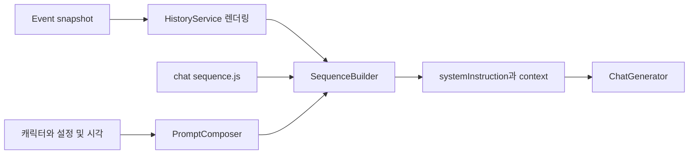

# 컨텍스트와 프롬프트

ChatContextPreparer는 같은 기준 시각으로 사건 기록과 프롬프트를 조립한다. 모델 입력의 내용과 순서를 바꾸려면 이 계층과 HistoryService를 함께 확인한다.

## 히스토리와 입력의 경계

HistoryService는 마지막으로 보낸 봇 SENT 사건까지를 `historyMessages`, 그 이후를 `pendingMessages`로 배치한다. 이 배치 경계와 처리 대상 입력의 경계는 다르다. 처리 대상은 ConversationState cursor 이후의 LIVE 사용자 사건과 재생성 입력 사건으로 결정한다.

EventRepository는 현재 전체 관찰 이력을 조회한다. `conversation.maxContextMessages`나 `maxHistoryDays`로 잘라내지 않는다. sequence의 history step에 `slice`를 지정하면 해당 history 배치만 자를 수 있으며 pending 전체를 자동 제한하지 않는다. 긴 대화의 토큰 한도·비용을 고려해 별도 정책을 설계해야 한다.

자신의 LIVE READ·SENT는 assistant, 그 밖의 관찰은 user로 표현한다. 모델 role과 실제 작성자는 별도 필드다. 봇 메시지의 수정·삭제·과거 조회도 user 관찰로 남지만 대상 작성자를 잃지 않는다.

## 전송 시각과 화자 표시

SequenceBuilder가 실제 사용할 history slice와 pending을 선택한 뒤 ObservationFormatter가 관찰 순서대로 표시한다. 날짜와 24시간제 `[HH:MM]`은 대상 메시지의 원래 전송 시각인 `Message.sentAt`을 사용한다. user 기록은 첫 항목·작성자 변경·전송 날짜 변경에 헤더를 붙이며, 같은 작성자가 연속해서 보낸 메시지는 직전 메시지와 전송 간격이 7분 이상이면 시각을 다시 표시한다. 마지막 헤더부터 누적한 경과 시간은 기준이 아니다.

수정·삭제·과거 조회와 그 직후 발언도 그룹을 구분한다. 이 사건의 헤더 역시 대상 메시지의 원래 전송 시각이며 수정·삭제·조회 시각을 뜻하지 않는다. 기록은 Event ID 순서를 유지하므로 과거 메시지 조회가 끼면 표시되는 전송 시각이 뒤로 갈 수 있다. 날짜는 해당 지역 전송 날짜가 바뀐 첫 user 기록 앞에 `--- 2026년 10월 30일 ---`처럼 붙이며 별도 메시지를 만들지 않는다. assistant가 먼저 날짜를 넘으면 다음 user 기록으로 미룬다. 전송 시각이 없거나 유효하지 않으면 날짜·시간을 생략하고 관찰·저장 시각으로 대신하지 않는다.

서버 채널의 헤더는 현재 서버 닉네임 → 글로벌 이름 → username 순으로 선택한다. DM과 서버가 없는 CLI 대화는 이름을 생략한다. 관찰 사건은 `대상 작성자:`로 발언과 구분한다. assistant에는 날짜·시간·이름 헤더를 붙이지 않지만 reply/react 참조에 필요한 고정 `#N`은 유지한다. 출력 파서에서 번호를 일괄 삭제하지 않는다.

이름은 한 줄·길이 제한을 적용하고 대괄호·개행·방향 제어 문자 등의 헤더 위조 요소를 제거한다. 예약 role 이름은 사용자 이름임을 표시한다. 동명이인은 `하늘 (@sky)`처럼 구분한다. 원문 멘션과 관찰 본문은 저장한 그대로 유지하고 모델에 표시할 때만 같은 ParticipantResolver로 `<@id>`·`<@!id>`를 이름으로 변환한다. 알 수 없는 멘션은 `@알 수 없는 사용자`로 표시한다.

## 참여자와 끝부분 블록

response step은 기존 응답 지시와 현재 시각에 참여자·관찰 표시 규칙을 더한 하나의 user 메시지다. 기본 배치는 history → response → pending 전체이며 마지막 user 하나만 따로 떼지 않는다. summary·fact·episode 주입은 여전히 미구현이다.

날짜·시각·화자 헤더와 고정 번호의 해석은 SequenceBuilder의 관찰 표시 규칙에서 관리한다. `default-v2`와 `default-v2/ko`의 system 템플릿은 이를 참조하며 별도의 시간 간격·AM/PM·번호 부재 규칙을 중복하지 않는다. 지식·이해 범위에 관한 규칙은 이 표시 계약과 별개다.

참여자 목록은 실제 선택된 관찰의 작성자 중 자신을 제외한 계정이다. 멘션된 계정도 이름 해석에는 쓰지만 발언하지 않았다면 목록에 추가하지 않는다. 5명 이하이면 이름·username·공개 서버 태그·관측 가능한 상태·활동을, 6명 이상이면 이름·username·태그만 넣는다. DM에서는 이름 대신 ‘상대’를 표시한다. 상태·활동은 관련 있을 때만 언급하도록 안내한다.

ParticipantService에 플랫폼별 조회 어댑터를 주입한다. Discord는 매 요청 캐시에서 현재 프로필과 프레즌스를 읽고 누락한 이름은 Event snapshot의 username·글로벌 이름으로 보완한다. ServerMember 테이블이나 전체 길드 fetch는 추가하지 않는다. 상태 누락은 오프라인으로 추정하지 않으며 DM의 길드 프레즌스도 추정하지 않는다. 도구 계약과 캐시 한계는 [Discord 참여자 조회](../플랫폼/Discord.md#참여자-조회)를 참고한다.

현재 시각·상태는 끝부분에서 바뀌지만 닉네임이나 이름 충돌 구성이 바뀌면 앞쪽 표시도 달라질 수 있다. prompt cache 적중을 보장하지 않는다. 같은 요청의 표시와 도구는 같은 ParticipantResolver를 공유한다. 도구가 새 멤버를 발견하면 맵을 확장하되 이미 표시한 이름은 유지한다.

## sequence 계약

`content/prompts/<prompt>/chat/sequence.js`는 비어 있지 않은 배열을 export한다. 정확히 한 step에 `role: "system"`이 있어야 하며 참조 파일의 존재를 확인한다.

| type | 동작 |
| --- | --- |
| `file` | chat 디렉터리의 `source` 템플릿을 렌더링 |
| `text` | `content` 문자열 렌더링 |
| `placeholder` | `template` 또는 `source`를 템플릿 표현식으로 렌더링 |
| `history` | 관찰 히스토리 삽입, 선택적 배열 `slice` 적용 |
| `pending` | 마지막 봇 전송 뒤 관찰 삽입 |
| `response` | `sources`·현재 시각·참여자·관찰 표시 규칙을 하나의 user 지시로 추가 |
| `cache-point` | 현재는 no-op. provider 캐시 메타데이터를 전달하지 않음 |

PromptComposer는 `data`, `system.now`, `runtime`, `config`, `character` 네임스페이스를 만든다. Handlebars 렌더러는 `src/utils/renderTemplate.js`, 시각·런타임 컨텍스트 구성은 `src/utils/templateContext.js`에서 확인한다. `character`는 identity 문자열로도 사용된다.

채팅은 캐릭터 `config.json`의 필수 `timezone`으로 메시지 전송 시각의 표시, 현재 시각, 나이·학년 계산의 기준을 통일한다. 한 요청에서 만든 system 컨텍스트를 identity와 모든 sequence step에 공유한다. `system.now.raw`는 초와 실제 시간대 오프셋을 포함한 ISO 8601이고, `date`·`time`·`weekday`·`year`도 같은 지역 날짜를 사용한다. 헤더 날짜의 언어는 `app.language`를 따르며 시간 헤더는 24시간제다. 이미지 도구의 시간대 우선순위는 `ai.image.timeZone` → `app.timezone` → `Asia/Seoul`로 채팅과 별개다.

systemInstruction은 모델 요청의 system 필드로 전달하고 context의 role은 assistant 또는 user로 정규화한다. JSON처럼 작성한 모델 도구 호출을 회수하는 예외 경로는 [도구와 이미지](도구와%20이미지.md)에 설명한다.

## 메신저 응답 길이와 분할

`default-v2`와 `default-v2/ko`는 일상 잡담을 짧게 쓰되 말풍선 수는 고정하지 않는다. 연속된 짧은 사용자 메시지는 하나의 발화로 해석하며, 각 메시지마다 별도의 답을 만들도록 요구하지 않는다. 반응만으로 충분한 상황에서는 후속 질문이나 보충 설명 없이 끝낼 수 있다. 필요한 질문과 요청받은 설명은 허용한다.

메시지를 나누기 전에 전체 내용에서 불필요한 반복과 일반론을 덜어내도록 안내한다. 반응 뒤의 별도 질문·논평이나 말을 거는 상대가 바뀌는 경계는 짧은 응답에서도 `[BREAK]`로 구분한다. 한 호흡의 구절이나 단어마다 나누지는 않는다. 응답 계약의 본문 한 줄은 API 텍스트 형식이며 플랫폼 메시지 하나를 뜻하지 않는다. 말풍선 수나 글자 수를 강제로 제한하는 런타임 계약은 아니며, 실제 전송 분할은 [메시지 분할](../대화/메시지%20분할.md)의 규칙을 따른다.

관련 파일은 두 팩의 `chat/messenger-style.md`, `chat/response-contract.md`, `chat/final-check.md`다. 메신저 표현 규칙은 history 앞에 배치하고, 응답 단계의 최종 점검에서 불필요한 질문·문장·말풍선과 분할 경계를 재확인한다. 입력 조립과 출력 파싱 관련 테스트는 아래 근거와 검증에 기록한다. 모델 비교는 실행하지 않았으며, 실제 모델의 분할 빈도와 대화 품질 개선 여부는 미검증이다.

## 선택적 무응답

AI는 상황에 따라 일반 messages, reply/react만 실행, 완전한 침묵을 선택할 수 있다. 응답 계약은 messages 본문을 비우는 것을 허용하며, 성공한 reply/react 뒤에 같은 답장이나 확인 문구를 추가하도록 강제하지 않는다. 현재 선택된 `default-v2` 팩의 응답 계약과 공개 테스트 팩에 이 선택지를 안내한다. 다른 비공개 팩을 사용할 때도 같은 런타임 계약에 맞춰 안내해야 한다.

빈 messages도 정상 완료하고 처리 cursor를 전진시킨다. 다음 입력의 처리 대상에 이미 소비한 사건을 다시 넣지 않지만, 해당 사건은 관찰 컨텍스트에 남을 수 있다. 침묵은 SENT를 만들지 않으므로 마지막 봇 발언을 기준으로 하는 history/pending 배치 경계는 바뀌지 않는다. 생성 이미지가 있으면 기존 태그 보정으로 이미지 전달을 유지한다. 완료·전송 시각 계약은 [생성과 전송 및 재생성](../대화/생성과%20전송%20및%20재생성.md)을 참고한다.

## 현재 없는 연결

`summary`·`embedding` 설정이 존재해도 요약·기억 검색을 컨텍스트에 자동 주입하지 않는다. `src/ai/summary.js`의 보조 함수는 현재 런타임에서 호출되지 않는다. 비공개 팩의 실제 문구는 이 위키에 복사하지 않는다.

## 클래스별 입력과 출력

| 클래스 | 하는 일 | 결과 |
| --- | --- | --- |
| EventRepository | 저장된 경험과 current Message를 트랜잭션으로 확인 | snapshot 범위·events·선택적 replay |
| HistoryService | replay 병합, 입력 판별, 관찰 렌더링과 배치 | historyMessages·pendingMessages·inputMessages·messageIds·eventSnapshot |
| HistoryMessageFormatter | 생성 이미지 첨부를 텍스트로 설명 | 이미지 ID·파일명과 조회한 이미지 생성 프롬프트 |
| ChatContextPreparer | 기준 시각 고정, 팩 조회, sequence 실행 | context·systemInstruction과 기록용 입력 |
| PromptComposer | 캐릭터·시각·설정 네임스페이스 구성 | 템플릿 렌더링 context |
| SequenceBuilder | step 배열을 순서대로 평가 | 독립 systemInstruction과 role/content 목록 |
| ObservationFormatter | 선택된 사건의 날짜·시간·작성자·멘션 표시 | 원문을 바꾸지 않은 모델용 role/content |
| ParticipantService / ParticipantResolver | 플랫폼 프로필 보완·이름 충돌 처리·조회 | 요청별 공유 이름 맵과 공개 프로필 |

Generation.input에 저장하는 inputMessages는 모델에 보낸 context 전체가 아니다. 이번에 처리할 사용자 사건의 렌더링 본문이다. 전체 모델 입력과 system 지시를 분석하려면 API request metadata도 확인한다.

## 두 경계가 다른 구체적인 예

사건이 READ 10, SENT 11, READ 12이고 cursor가 10이라고 가정한다. 화면 배치상 history에는 10과 11, pending에는 12가 들어간다. 처리 입력은 cursor 뒤의 LIVE 사용자 사건인 12다.

반대로 일부 출력 SENT 11 뒤에 생성이 실패하고 cursor가 0이면 READ 10은 history 배치에 있어도 처리되지 않은 입력으로 남을 수 있다. pendingMessages라는 이름만 보고 처리 대상을 결정하면 이전 실패 입력을 놓친다.

위 숫자는 설명용 Event ID다. ID가 전역이므로 실제 같은 채널의 사건 번호 사이에 다른 채널의 사건이 들어갈 수 있다.

## sequence를 바꿀 때 확인할 것

sequence의 step 순서가 실제 모델 메시지 순서가 된다. 파일 이름만 바꿔도 기존 import된 sequence 배열이 즉시 갱신되는 것은 아니다. 팩 변경 검증은 새 프로세스에서 수행한다.

file·text·placeholder가 role을 생략하면 user로 배치한다. response step은 지정한 sources를 합치고 같은 기준 시각의 Current Time을 덧붙인다. history와 pending은 이미 렌더링한 관찰 role을 유지한다.

관찰의 `observedAt`은 사건을 읽은 시각이며 기록·처리 경계와 로그에 사용한다. 헤더의 `sentAt`과는 별개다. EventRepository가 대상 Message의 전송 시각을 snapshot에 포함하고 HistoryService가 표시 계층에 전달한다. history slice가 바뀌면 표시 대상부터 날짜·시간·그룹을 계산하므로 잘린 첫 user 기록에도 독립적인 헤더가 생긴다.

현재 buildContext는 일반 config 전체를 템플릿에 제공한다. API 키·서비스 계정 인증 정보는 ConfigManager와 분리되어 이 컨텍스트에 포함되지 않는다. 인증 객체를 템플릿 변수로 전달하지 않는다.

## 근거와 검증

구현: `src/chat/context/ObservationFormatter.js`, `src/chat/context/ParticipantService.js`, `src/chat/context/ParticipantResolver.js`, `src/chat/context/ChatContextPreparer.js`, `src/chat/context/SequenceBuilder.js`, `src/chat/context/PromptComposer.js`, `src/utils/templateContext.js`, `src/messages/HistoryService.js`, `src/ai/chat.js`.

테스트: `test/chat/context/Participants.test.js`, `test/chat/context/ContextAssembly.test.js`, `test/chat/context/SequenceBuilder.test.js`, `test/chat/context/PromptPipeline.test.js`, `test/chat/context/ChatContextPreparer.test.js`, `test/utils/templateContext.test.js`, `test/ai/messages.test.js`, `test/chat/response/AIResponseParser.test.js`, `test/integration/ChatPipeline.integration.test.js`.

[홈](../홈.md) · [캐릭터](캐릭터.md) · [테스트와 프롬프트 비교](../개발/테스트와%20프롬프트%20비교.md)
