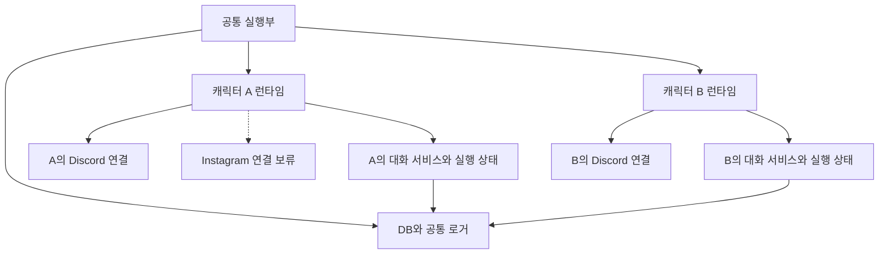

# 캐릭터 중심 다중 플랫폼 실행 계획

작성일: 2026-11-07 · 상태: 1~5단계 코드 구현 완료 · 실제 Discord 다중 계정 운영 확인 별도

정책 확정일: 2026-11-08

한 프로세스에서 여러 캐릭터를 실행하고, 각 캐릭터가 Discord와 Instagram 등 여러 플랫폼의 계정을 사용하도록 실행 구조를 개편한다. 공통 플랫폼 데이터는 공유하면서 캐릭터의 관찰·대화·생성 상태는 독립적으로 유지한다.

현재 플랫폼 공통 대화 파이프라인을 활용한다. 실행 단위를 캐릭터로 정리하고 계정 소유 관계와 데이터 처리 범위를 보완한다. 이번 단계에서 생활 시뮬레이션 전체나 범용 에이전트 프레임워크를 만들지는 않는다.

계정·관찰 분리, 캐릭터별 런타임과 상호 대화, 연결별 계약, 목록 기반 실행·배포·CLI 선택을 구현했다. 자동 검증은 가짜 연결·모델과 임시 DB를 사용한다. 실제 Discord 다중 계정의 인증·서버 운영 확인은 아직 별도 절차이며 Instagram은 보류한다. 현재 동작은 [전체 아키텍처](../구조/전체%20아키텍처.md), [플랫폼 독립 계약](../구조/플랫폼%20독립%20계약.md), [메시지와 관찰 사건](../대화/메시지와%20관찰%20사건.md)을 기준으로 확인한다.

## 목표와 범위

### 이번 개편의 목표

- 한 프로세스가 여러 캐릭터 런타임을 실행한다.
- 캐릭터 하나가 여러 플랫폼 계정을 소유하고 같은 정체성으로 활동한다.
- 같은 채널의 두 캐릭터가 같은 메시지를 각각 관찰하고 독립적으로 응답한다.
- 한 캐릭터의 생성 취소·설정 변경·연결 종료가 다른 캐릭터의 상태를 변경하지 않는다.
- 플랫폼의 최신 확인 상태와 캐릭터가 알고 있는 내용을 분리한다.
- Instagram 도입에 필요한 계정·입력·전송·도구 경계를 준비한다.

### 구현 범위의 제한

초기에는 캐릭터당 플랫폼별 계정 하나, 동일 characterId의 활성 런타임 하나를 지원한다. 서로 다른 플랫폼이나 채널의 대화는 병렬로 진행할 수 있다. 캐릭터 전체를 하나의 대화 큐로 직렬화하지 않는다.

기존 Node.js·Prisma·SQLite 구성을 유지한다. 프로세스 분산, 동적 플러그인 시스템, 캐릭터 무중단 이동, 같은 캐릭터의 다중 프로세스 실행, 장기 기억과 생활 스케줄러는 후속 범위다. 후방 호환 계층과 데이터 마이그레이션은 만들지 않는다. 개발 DB 재구성이 필요한 단계는 적용 절차에 명시하며, 계획서 작성 자체는 DB 변경을 포함하지 않는다.

Instagram 실제 연동은 보류한다. 이번 완료 범위는 다중 Discord 운영과 Discord·CLI 및 테스트용 두 번째 연결을 통한 플랫폼 경계 검증이다. Instagram의 최초 기능과 API 계약은 후속 작업에서 결정한다.

### 확정한 실행 정책

- 캐릭터끼리 서로의 발언을 관찰하고 자동 응답할 수 있다. 자기 계정의 발언은 응답 입력에서 제외한다. 외부 봇의 자동 응답 허용까지 확대하지 않는다.
- 어느 캐릭터든 로그 목적지로 구독한 채널은 모든 캐릭터의 대화에서 제외한다. 로그 구독 자체는 캐릭터별로 관리한다.
- 새 대화 세션 시작 시 해당 플랫폼 계정으로 최근 메시지 최대 50건을 읽어 HISTORY로 기록한다. 세션 진행 중에는 자동 재조회하지 않으며, HISTORY 읽기 자체로 응답을 예약하지 않는다.
- Instagram의 인증·읽기·게시·전송 구현과 실제 연동 검증은 이번 작업에 포함하지 않는다.

최근 50건 HISTORY·캐릭터 간 자동 대화·캐릭터별 로그 구독과 전역 로그 채널 제외를 적용했다.

## 현재 구조와 변경 이유

| 현재 구현 | 활용하거나 수정할 부분 |
| --- | --- |
| createContainer가 서비스와 세션·버퍼·이벤트 버스를 새로 조립 | 캐릭터별 런타임의 기반으로 유지 |
| 공통 Host가 캐릭터별 container와 플랫폼 연결 조립 | 모든 계정 준비 후 입력 활성화. 공통 DB 종료는 Host만 담당 |
| platformClients와 participantSources가 플랫폼별 Map | 캐릭터당 플랫폼별 계정 하나라는 범위에서 유지 |
| 입력 플랫폼별 연결 정책 라우팅 | Discord 정책과 CLI 소유 채널 정책 적용 |
| User.characterId로 캐릭터와 플랫폼 계정 소유권 연결 완료 | 계정 재사용·충돌 거부와 관찰·생성 소유 범위 적용 |
| Event·Generation·ConversationState에 characterId 존재 | 관련 조회·취소·관찰 처리에 소유 범위 적용 완료 |
| 원본 저장과 캐릭터별 관찰 중복 분리 완료 | changed와 observedChanged를 분리해 새 관찰로 응답을 예약 |
| EventRepository.snapshot은 기존 Event만 조회 | 새 세션의 계정별 50건 HISTORY 읽기는 명시적 경로로 분리 완료 |
| SENT는 전송 확인 경로에서 명시 | 계정 소유권으로 캐릭터를 식별하고 상호 응답 허용 |
| Policy·LogSubscription은 캐릭터별 | 어느 캐릭터든 구독한 로그 채널은 전체 대화에서 제외 |
| 도구의 입력 출처·대상 계정·채널 기능을 분리 | 준비된 연결의 작업 허용 여부를 선택·실행 시 검사 |

주요 구현 경로: `src/core/container.js`, `src/platforms/discord/createDiscordApplication.js`, `src/platforms/cli/index.js`, `src/accounts/BotAccountService.js`, `src/messages/MessageService.js`, `src/repositories/EventRepository.js`, `src/repositories/GenerationRepository.js`, `src/tools/ToolRegistry.js`, `prisma/schema.prisma`.

## 캐릭터 중심 실행 구조



| 구성 요소 | 소유하는 책임 |
| --- | --- |
| 공통 실행부 | 환경과 설정 로드, DB·로거 준비, 캐릭터 목록 실행, 프로세스 신호와 전체 종료 |
| 캐릭터 런타임 | 캐릭터 설정, 계정 소유 관계, 공통 대화 서비스, 세션·버퍼·요청 취소, 캐릭터 범위 Repository |
| 플랫폼 연결 | 인증, 입력 수신, 플랫폼 명령, 참가자 조회, 정책 평가, 전송 기능, 연결 시작과 종료 |
| 대화 작업 | 입력 snapshot, 현재 turn, 대상 채널과 계정, 생성 ID, 취소 신호 |

createContainer를 캐릭터 단위 조립 함수로 정리한다. CharacterRuntime이라는 이름을 사용하더라도 별도 상속 계층을 만들지 않고 현재 객체 묶음과 필요한 수명주기 함수로 시작한다.

조립은 공통 자원 준비 → 캐릭터 설정 검증 → 플랫폼 연결 객체 준비 → 캐릭터 서비스 조립 → 이벤트 연결과 계정 준비 → 입력 수신 활성화 순서로 한다. 플랫폼별 인증 절차 차이는 각 연결이 처리하며, 자기 계정 식별이 끝나기 전에 대화 입력을 처리하지 않는다.

프로세스 신호는 한 번 등록한다. 종료 시 입력 수신을 막고 버퍼·정책 타이머를 정리한 뒤, 요청을 취소하고 진행 작업을 제한된 시간 동안 기다린다. 각 캐릭터의 진행 상태와 로그를 정리하고 연결을 닫은 다음 공통 DB를 마지막에 닫는다. 캐릭터별 종료 함수에서는 process.exit나 공통 DB disconnect를 호출하지 않는다.

연결 하나의 인증·통신 실패는 해당 연결 상태로 보고하고 나머지 연결은 유지하는 것을 기본안으로 한다. 공통 DB 준비 실패는 전체 기동 실패다. 프로세스 자체의 장애와 이벤트 루프 지연은 모든 캐릭터에 영향을 주므로 프로세스 분리 수준의 장애 격리를 보장하지 않는다.

## 정체성과 계정

User는 사람과 캐릭터를 포함한 공통 주체로 유지한다. 별도 Bot 테이블은 만들지 않는다. 1단계에서 User에 nullable unique characterId를 추가했다.

```text
User
  id
  characterId?  unique

PlatformAccount
  id
  userId
  platform
  platformId
```

캐릭터 초기화 시 characterId로 User를 찾거나 한 번 생성하고, 그 캐릭터의 모든 플랫폼 계정을 같은 User에 연결한다. 외부 사람이나 외부 봇의 User에는 characterId가 없다. 인격·캐릭터 원문은 기존 콘텐츠 파일에 유지한다.

계정의 소유권이 다른 캐릭터와 충돌하면 기동 검증에서 오류로 처리한다. 플랫폼 계정을 연결한다는 이유로 기존 외부 사용자를 자동 병합하지 않는다. 플랫폼이 보고한 isBot은 캐릭터 소유권을 결정하지 않는다.

설정은 공통 실행 설정, 캐릭터별 설정, 캐릭터의 플랫폼 연결 설정으로 구분한다. 인증 값은 환경 변수에서 별도로 읽는다. 하나의 ConfigManager나 process.env의 현재 캐릭터 값을 바꿔 가며 여러 캐릭터를 실행하지 않는다. 로그에는 characterId와 플랫폼 계정 식별자를 포함한다.

캐릭터·계정 목록 변경은 초기에는 재시작으로 적용한다. 기존 설정 watcher를 유지하는 필드는 런타임 소유 범위를 명시하고, 재시작이 필요한 값과 구분한다. Discord 명령 배포와 CLI의 캐릭터 선택도 같은 설정 목록을 사용하도록 정리한다.

## 공통 플랫폼 상태와 캐릭터 경험

### 데이터 소유 범위

| 데이터 | 범위와 계약 |
| --- | --- |
| User·PlatformAccount | 공통 주체와 계정. 캐릭터와 계정의 소유 관계 포함 |
| Server·Channel | 공통 플랫폼 공간. 접근 권한이나 캐릭터별 활성화는 별도 |
| Message | 메시지의 식별자와 마지막으로 확인한 상태. 플랫폼별 원본은 한 건 |
| Event | 캐릭터별 불변 관찰 snapshot |
| ConversationState | characterId와 channelId별 처리 cursor |
| Generation | 캐릭터별 생성 입력·출력과 상태 |
| MessageAction | 해당 Generation의 외부 행동 실행 기록 |
| Policy | 캐릭터와 플랫폼 및 대상 범위별 정책 |
| 로그 구독 | 캐릭터별 Discord 로그 목적지 |
| 기억·생활 상태 | 후속 구현에서 캐릭터 소유권을 명시. 현재 Memory를 자동으로 공통 인격 저장소로 간주하지 않음 |

Message는 단순 폐기 가능한 캐시가 아니다. 채널별 고정 번호와 Event·Generation 참조가 연결된 상태 저장소다. 다만 항상 최신인 실제 플랫폼 상태를 보장하지는 않는다. 캐릭터의 경험 본문은 Message.content가 아니라 Event.snapshotContent와 첨부 snapshot에서 읽는다.

플랫폼 ID의 고유 범위는 새 어댑터 도입 시 확인한다. 계정이나 공간에 한정된 ID를 플랫폼 전체 고유 ID처럼 사용하지 않는다.

### 서로 다른 내용을 알고 있는 사례

처음에는 A와 B가 모두 메시지 #100의 “내일 만나자”를 읽었다. 이후 “오늘 만나자”로 수정됐지만 A만 주시 중이었다.

| 저장 위치 | 내용 | 의미 |
| --- | --- | --- |
| Message #100 | 오늘 만나자 | 마지막으로 확인한 플랫폼 상태 |
| A의 READ | 내일 만나자 | 최초 관찰 |
| A의 EDIT | 오늘 만나자 | 수정 목격. previousContent는 A가 이전에 읽은 내용 |
| B의 READ | 내일 만나자 | B의 마지막 경험. 수정 목격 없음 |

A는 변경을 알고 B는 원문만 알고 있다. B의 문맥을 반복 구성해도 새 관찰을 만들지 않는다. B가 나중에 명시적으로 다시 읽으면 그 시각에 source=HISTORY인 READ를 추가한다. 수정 순간을 목격한 EDIT로 소급하지 않는다.

수신 사건은 해당 연결이 받은 snapshot으로 기록한다. 그 사이 다른 연결이 갱신한 Message.content를 복사해 수신 당시 경험을 대체하지 않는다. 오래된 사건이 늦게 도착해도 공통 최신 상태를 과거로 되돌리지 않으며, 캐릭터의 경험 순서와 플랫폼 수정 시각을 구분한다.

### 관찰 처리와 문맥 구성

1. 플랫폼 입력에서 계정·공간·원본 식별자와 수신 내용을 정규화한다.
2. 캐릭터의 접근 권한과 주시 여부 등 관찰 조건을 확인한다.
3. 공통 Message 갱신과 해당 캐릭터 Event 기록을 한 트랜잭션에서 처리한다. 원본 변경이 없더라도 그 캐릭터에게는 새로운 관찰일 수 있다.
4. 그 캐릭터의 새 관찰과 응답 정책을 기준으로 대화를 예약한다. 공통 Message의 changed 값만으로 응답 여부를 결정하지 않는다.
5. 문맥 구성은 해당 캐릭터의 기존 Event와 처리 cursor를 조회한다. Generation 입력 저장은 유지하되 문맥 조회가 새로운 관찰을 만들지는 않는다.

EventRepository.snapshot의 HISTORY 생성 루프를 명시적인 과거 내역 읽기 단계로 옮긴다. 새 대화 세션 시작 시 해당 플랫폼 계정으로 최근 메시지 최대 50건을 조회하고 HISTORY READ로 기록한다. 세션 진행 중에는 자동 재조회하지 않는다. 여기서 새 세션은 캐릭터·플랫폼·채널별 주시가 종료된 뒤 새 입력으로 대화를 시작하는 경우를 뜻하며, 매 응답이나 생성 재시도마다 다시 읽지 않는다. 현재 주시 기간은 진행 중인 turn과 종료 후 10분이며, 구현 시 `src/chat/ConversationSession.js`와 관련 테스트를 기준으로 연결한다.

과거 내역은 문맥으로 사용하되 HISTORY 읽기 자체로 응답을 예약하지 않는다. 대화를 시작한 LIVE 입력은 별도 관찰로 보존하고 동일 사건의 중복 관찰을 방지한다. 50건은 플랫폼에서 읽는 범위이며 모델 문맥 제한과는 별개다. 공통 저장소에 데이터가 있다는 사실만으로 접근을 허용하지 않는다. 과거 내역 읽기는 해당 계정의 접근 범위와 실제 읽기 근거를 확인한다.

중복 방지는 원본과 관찰에 각각 적용한다. 같은 메시지를 A와 B가 받으면 Event는 각각 생기고, A가 같은 사건을 재수신하면 중복 Event는 생기지 않아야 한다. 플랫폼 사건 ID·수정 버전 등 이용 가능한 근거로 판정하며, 본문만으로 동일 사건을 판단해 되돌림 편집을 누락하지 않는다. 구체적인 키는 수신 계약과 재현 테스트를 기준으로 결정한다.

### 전송과 삭제 및 재생성

자기 계정 여부는 런타임의 계정 소유 관계로 확인한다. botId는 현재 연결의 자기 플랫폼 사용자 ID라는 의미가 드러나도록 정리한다. SENT는 전송 확인 경로에서 명시하고, 다른 봇의 발언은 관찰자의 READ로 처리한다. 플랫폼의 isBot 여부와 응답 대상 정책은 별개다.

다른 캐릭터가 소유한 계정의 LIVE 발언은 사람의 발언과 마찬가지로 응답 가능한 입력으로 처리한다. `isBot`만으로 캐릭터 간 응답을 차단하지 않는다. 외부 봇은 관찰과 자동 응답을 구분해 기본 자동 응답 대상에서 제외한다. 로그 채널 제외는 작성자의 종류와 관계없이 우선 적용한다. 캐릭터가 응답하지 않기로 결정하는 기존 빈 messages 완료 계약은 유지한다.

전송 응답과 다른 캐릭터의 수신 이벤트 도착 순서는 고정되지 않는다. B가 A의 출력 Message를 먼저 저장했어도 A의 전송 확인에서 출력 Generation 연결과 A의 SENT를 완성해야 한다. 원본이 이미 존재한다는 이유로 이를 생략하지 않는다.

Message.generationId는 해당 메시지를 생성한 출력의 연결로 정리한다. 입력 사용 기록은 각 Generation.input과 eventSnapshot에 남겨, 같은 입력을 A와 B가 사용해도 연결을 덮어쓰지 않게 한다. 생성 정보 조회와 재생성은 이 의미에 맞춰 수정한다.

플랫폼에서 실제 삭제되면 공통 Message에 삭제를 반영한다. DELETE 경험은 각 캐릭터의 관찰 조건에 따라 별도로 기록한다. A가 먼저 삭제 상태를 저장했다고 B의 목격 기록을 생략하지 않는다.

캐릭터의 기록 초기화와 플랫폼 원본 삭제는 별도 유스케이스로 구분한다. A의 생성 철회가 B의 과거 관찰을 자동으로 숨기지 않도록 Generation.discardedAt 기반 Event 필터도 소유 범위를 정리한다. B가 이미 읽은 A의 발언은 B의 경험에 남고, 실제 삭제를 목격했다면 그 이후 DELETE가 추가된다.

## 플랫폼 계약과 도구

NormalizedMessage와 ChannelPort를 공통 대화 계약으로 유지한다. 대화 밖의 게시·게임 행동을 모두 ChannelPort.send에 넣지 않는다. 실제 기능을 도입할 때 작은 전용 계약을 추가한다.

- sendTyping·reply·react 등은 선택적인 기능으로 취급한다. 제공하지 않는 기능의 도구는 모델에 노출하지 않는다.
- 메시지 길이·첨부 지원 같은 전송 제약은 연결이 제공한다. 공통 MessageSender는 대상 연결의 제약으로 분할·전송한다.
- 첨부는 공통 데이터로 표현하고 플랫폼 SDK 업로드 형식은 어댑터에서 변환한다.
- Discord 서버·카테고리·채널 정책은 Discord 구현에 둔다. 공통 대화 계층은 해당 연결의 허용 여부를 조회한다.
- 각 도구는 입력 출처와 실행 대상을 구분한다. 현재 채널 답장은 그 대화 연결에, 플랫폼 전용 행동은 대상 계정에 연결한다.
- 사용 가능한 도구는 계정 연결 상태·제공 기능·현재 작업의 허용 정책으로 선택한다. 입력 플랫폼이 다르다는 이유만으로 차단하거나, 계정이 있다는 이유만으로 모든 행동을 허용하지 않는다.
- 플랫폼 전용 도구의 SDK 의존성은 전용 구현에 유지하고 공통 대화 로직으로 확산시키지 않는다.

이번 작업에서는 기존 Discord·CLI와 테스트용 두 번째 연결로 경계를 검증한다. 실제 Instagram의 인증·읽기·게시·전송 조건은 후속 작업에서 최초 기능을 선정한 후 공식 API를 확인해 구체화한다.

## 단계별 구현과 완료 조건

| 단계 | 작업 | 검증 및 완료 조건 |
| --- | --- | --- |
| 1 기준선과 계정 소유권 — 완료 | 기존 테스트 확인, User.characterId 추가, 계정 초기화 변경, 캐릭터별 설정 계약 정리 | 같은 캐릭터의 두 플랫폼 계정이 같은 User에 연결되고 계정 소유 충돌을 거부 |
| 2 공통 상태와 관찰 분리 — 완료 | CREATE·UPDATE·DELETE의 원본 및 관찰 중복 판정 분리, 명시적 HISTORY 읽기, snapshot 조회 분리, 출력 연결 정리 | A만 목격한 수정이 B의 문맥에 유입되지 않음. 입력 공유와 전송 경쟁 순서 검증 |
| 3 캐릭터별 실행 범위 — 구현·자동 검증 완료 | 생성 취소·재생성·조회·정책·로그 범위 적용, 캐릭터별 container와 플랫폼 연결 조립, 캐릭터 간 자동 응답, 공통 종료 처리 | 두 캐릭터가 같은 채널에서 서로 응답하며 독립 실행됨. 로그 채널은 모두 대화에서 제외되고 A의 종료·취소가 B에 영향을 주지 않음 |
| 4 다중 플랫폼 계약 — 구현·자동 검증 완료 | 연결별 정책·전송 제약·선택 기능·자기 계정 판별, 도구 대상과 허용 조건 정리 | 같은 캐릭터가 두 플랫폼에서 별도 대화 상태와 올바른 계정으로 실행됨 |
| 5 운영 — 코드·자동 검증 완료, 실제 연동 확인 별도 | 실행·명령 배포·CLI 선택·오류 상태 안내 정리 | 다중 Discord 기동·부분 실패·선택 실행을 자동 검증. 실제 다중 계정 운영 확인은 별도, Instagram은 보류 |

2단계와 3단계를 완료하기 전에는 Client를 여러 개 생성했다는 이유만으로 다중 캐릭터 지원 완료로 판단하지 않는다. 단계마다 관련 현재 동작 문서를 갱신하고 아래 회귀 사례를 유지한다.

### 1단계 구현 기록 · 2026-11-08

- 기존 전체 테스트 319개 통과를 기준선으로 확인했다.
- 구현 후 전체 `npm test` 331개가 통과했다. Prisma Client 생성과 격리 DB의 새 스키마 적용도 검증했다.
- User.characterId와 PlatformAccountRepository.initCharacterAccount를 추가했다. 소유권 확인·캐릭터 User 준비·플랫폼별 계정 하나 제한·계정 저장은 한 트랜잭션이며 외부 계정을 자동 병합하지 않는다.
- 공통 YAML에 `characters: [{id, connections, settings}]`를 정의하고 createCharacterConfigManager로 설정을 분리했다. `character`는 현 단일 실행 대상을 선택하며 ID와 connections는 재시작으로 적용한다. 상세 형식은 [모델과 설정](../AI/모델과%20설정.md#캐릭터별-실행-설정)에 있다.
- Discord는 로그인 후 계정 초기화를 기다리고, 그 전 메시지·명령 이벤트를 처리하지 않는다. CLI는 캐릭터별 모의 계정 ID를 사용한다.
- 기존 DB와 계정은 이관하지 않는다. 적용 시 [개발 DB 재구성 절차](../데이터/데이터%20모델.md#1단계-변경-적용)를 따른다. 이번 검증에서 실제 개발 DB는 변경하지 않는다.
- 계정 회귀는 `test/accounts/BotAccountService.test.js`, 설정 격리는 `test/config/characterSettings.test.js`, 입력 차단과 기동 실패는 `test/platforms/discord/createDiscordApplication.test.js`·`startup.test.js`에서 검증했다. 1단계 완료 당시 상호 대화·50건 HISTORY·다중 기동은 후속 범위로 남겼다.

### 2단계 구현 기록 · 2026-11-08

- Event.observationKey와 캐릭터별 관찰 고유 키를 추가했다. 공통 원본 중복과 별개로 CREATE·EDIT·DELETE·SENT를 기록하고, 수정 수신 본문·첨부와 editedAt을 그대로 보존한다.
- EventRepository.snapshot의 HISTORY 쓰기를 제거했다. 새 세션 시작 입력 이전 최대 50건은 해당 계정의 ChannelPort.readHistory에서 읽어 기록한다. Discord는 실제 API, CLI는 선택한 로컬 UI 채널의 원본 DB를 사용한다. 조회 실패 시 공통 DB로 대체하지 않는다.
- Message.generationId는 출력 연결만 유지한다. 입력은 각 Generation.input·eventSnapshot에 보존하고 발송 확인은 수신 측이 먼저 저장한 원본에도 자기 SENT와 출력 연결을 완성한다. 자기 출력 철회는 다른 캐릭터의 경험을 숨기지 않는다.
- 통합 테스트에서 캐릭터별 중복·수정 목격 차이·본문 되돌림과 늦은 수정·반복 문맥 조회·삭제 재수신·권한 없는 HISTORY·50건과 세션 재조회 조건·입력 공유·전송 확인 경쟁을 검증했다. 구현 전 전체 331개, 구현 후 전체 `npm test` 341개가 통과했다. 실제 Discord API 호출 없이 어댑터의 조회 옵션과 반환 snapshot 계약을 검증했다.
- 스키마와 기존 생성 연결의 의미가 바뀌었으므로 [개발 DB 재구성 절차](../데이터/데이터%20모델.md#1단계-변경-적용)를 적용한다. 자동 테스트는 임시 DB만 사용한다. 다중 런타임과 캐릭터별 실행 범위는 후속 3단계 기록에 있다.

### 3~5단계 구현 기록 · 2026-11-08

- 공통 main·Host와 플랫폼 연결을 분리했다. 모든 계정 준비 후 입력을 열며 같은 characterId의 중복 활성 런타임을 거부한다. 개별 연결 실패는 격리하고 사용 가능한 연결이 전혀 없으면 정리 후 실패한다.
- GenerationRepository·생성 정보 조회·재생성·Policy·로그 구독을 캐릭터로 제한했다. 재생성 실행은 플랫폼·채널·출력 소유권을 확인하며 Gateway 삭제가 먼저 도착해도 자기 출력 참조를 검증할 수 있다. 이미지 생성 입력 조회도 다른 캐릭터에 노출하지 않는다.
- 다른 캐릭터 계정의 발언을 응답 입력에 포함한다. 자기 발언과 외부 봇은 자동 응답에서 제외한다. LogSubscription이 하나라도 있는 채널은 모두의 대화에서 제외한다.
- 한 캐릭터의 여러 플랫폼 대화는 채널별로 병렬 실행한다. 캐릭터 종료는 입력 차단·abort·최대 5초 대기·자기 생성 취소·로그와 연결 닫기 순서이며 공통 DB는 전체 종료에서 한 번만 닫는다.
- 전송 길이·첨부 지원과 타이핑·reply·react를 대상 연결에서 판정한다. 공통 파일은 path 데이터이고 SDK 업로드 형식은 어댑터에서 만든다. Discord 상태·활동 도구는 입력 플랫폼과 독립된 자기 Discord 연결의 명시적인 작업 허용을 검사한다.
- npm start/discord와 명령 배포는 목록 전체, --character는 선택 계정을 사용한다. CLI는 선택한 캐릭터의 CLI·Discord를 같은 런타임에 연결하고 소유 채널 정책으로 목록·입력·전송을 제한한다.
- 가짜 연결과 임시 DB로 다중 기동·부분 실패·종료·캐릭터 상호 대화·취소 격리·두 플랫폼 동시 진행·도구 대상과 기능을 검증했다. 실제 서버 로그인·명령 배포·장시간 자율 대화는 실행하지 않았다. 실제 확인에는 설정된 서로 다른 두 Discord 계정과 서버의 캐릭터별 대화 정책이 필요하다.
- 최종 전체 `npm test` 354개가 통과했다(실패 0). 일반 사용자와 다른 캐릭터는 로그의 대기 입력에 포함하고 자기 출력 삭제는 제외하는 회귀, 다른 캐릭터의 이미지 생성 입력 조회 차단도 검증했다. Prisma Client 생성과 임시 DB의 새 스키마 적용을 확인했다.
- Policy 키 변경과 LogSubscription 추가에 따라 [개발 DB 재구성](../데이터/데이터%20모델.md#1단계-변경-적용)이 필요하다. 기존 설정·DB를 자동 이관하거나 reset하지 않는다.

### 핵심 회귀 사례

| 사례 | 기대 결과 |
| --- | --- |
| 같은 CREATE를 A·B가 수신하고 각각 재수신 | Message와 채널 번호는 하나, 최초 관찰은 캐릭터별 한 번 |
| A만 주시 중 수정 수신 | Message와 A의 경험만 변경. B의 기존 snapshot 유지 |
| A·B가 모두 같은 수정을 목격 | 수신 순서와 무관하게 각각 EDIT 생성 |
| 이전 본문으로 되돌리는 편집과 늦은 사건 | 실제 재편집을 중복으로 누락하지 않고 최신 상태를 역행시키지 않음 |
| B의 문맥을 반복 구성 | 새 Event와 새로운 지식을 만들지 않음 |
| B가 허용된 과거 내역을 다시 읽음 | 그 시각의 HISTORY READ 생성. LIVE EDIT로 오인하지 않음 |
| 새 세션 시작과 같은 세션의 연속 응답 | 해당 계정으로 최근 최대 50건을 읽고, 세션 진행 중에는 재조회하지 않음. HISTORY 자체로 응답을 예약하지 않음 |
| B가 접근할 수 없는 채널의 공통 Message 존재 | B의 조회·문맥·도구에서 노출되지 않음 |
| A·B의 같은 DELETE 수신 | 공통 삭제는 한 번, 각자의 목격은 보존 |
| B가 A의 발송 메시지를 먼저 저장 | A의 출력 Generation 연결과 SENT가 정상 완성됨 |
| A·B가 같은 메시지를 입력으로 생성 | Generation별 입력 보존, Message의 입력 연결 덮어쓰기 없음 |
| A의 응답 재생성 또는 기록 초기화 | B가 이미 읽은 경험과 진행 작업은 유지 |
| isBot 표시가 없는 자기 계정 | 자기 전송과 외부 발화를 정확히 구분 |
| A의 발언을 B가 수신 | B의 READ와 응답 입력에 포함됨. B의 발언도 A가 같은 방식으로 처리하고 자기 발언에는 응답하지 않음 |
| 외부 봇의 발언을 수신 | 관찰은 보존하되 기본 자동 응답 대상에서는 제외 |
| A만 구독한 로그 채널에 A·B가 메시지 수신 | 작성자와 사건 종류에 관계없이 두 캐릭터 모두 대화에서 제외 |
| 두 캐릭터와 두 플랫폼 동시 실행 | 세션·cursor·취소·도구 계정이 섞이지 않음 |
| 타이핑 기능 없는 연결과 다른 길이 제한 | 지원 기능과 전송 제한에 맞게 동작 |
| 한 연결의 인증 실패와 캐릭터별 종료 | 다른 연결의 작업 유지, 공통 DB는 전체 종료 시 한 번 닫힘 |

## 수정 경로와 테스트

아래는 현재 구현과 회귀 테스트의 주요 경로다.

| 영역 | 주요 구현 경로 | 기존 테스트 |
| --- | --- | --- |
| 조립과 종료 | `src/main.js`, `src/core/host.js`, `src/core/container.js`, `src/core/shutdown.js`, `src/platforms/discord/createDiscordApplication.js`, `src/platforms/cli/connection.js` | `test/core/host.test.js`, `test/core/container.test.js`, `test/core/shutdown.test.js`, `test/platforms/discord/createDiscordApplication.test.js`, `test/platforms/discord/startup.test.js` |
| 계정과 설정 | `src/accounts/BotAccountService.js`, `src/character/config.js`, `src/config/index.js`, `src/config/selection.js`, `src/platforms/discord/credentials.js`, `prisma/schema.prisma` | `test/character/config.test.js`, `test/config/createConfigManager.test.js`, `test/config/selection.test.js`, `test/platforms/discord/credentials.test.js` |
| 상태와 관찰 | `src/messages/MessageService.js`, `src/messages/HistoryService.js`, `src/messages/MessageHandler.js`, `src/repositories/MessageRepository.js`, `src/repositories/EventRepository.js` | `test/messages/MessageService.test.js`, `test/messages/HistoryService.test.js`, `test/messages/MessageHandler.test.js` |
| 생성과 재생성 | `src/repositories/GenerationRepository.js`, `src/chat/ChatGenerationLifecycle.js`, `src/application/RerollConversation.js`, `src/application/GetGenerationInfo.js` | `test/chat/ChatGenerationLifecycle.test.js`, `test/application/useCases.test.js`, `test/integration/ChatPipeline.integration.test.js` |
| 정책과 로그 | `src/repositories/PolicyRepository.js`, `src/platforms/discord/policy/DiscordPolicyService.js`, `src/platforms/discord/logging/DiscordLogRepository.js`, `src/core/logger.js` | `test/platforms/discord/policy.test.js`, `test/platforms/discord/log.test.js`, `test/core/logger.test.js` |
| 전송과 도구 | `src/application/contracts.js`, `src/messages/MessageSender.js`, `src/tools/ToolRegistry.js`, `src/tools/ToolExecutionContextFactory.js`, `src/platforms/discord/adapter.js` | `test/messages/MessageSender.test.js`, `test/tools/ToolRegistry.test.js`, `test/tools/ToolExecutionContextFactory.test.js`, `test/platforms/discord/adapter.test.js`, `test/platforms/cli/adapter.test.js` |

자동 테스트는 격리된 테스트 DB와 가짜 플랫폼 연결·모델을 사용한다. 실제 인증 정보나 운영 DB에 의존하지 않는다. 단계별 대상 테스트를 통과한 뒤 전체 npm test를 수행하고, 실제 Discord 동작은 별도의 연동 확인으로 검증한다. Instagram 실제 연동 검증은 후속 작업이다.

## 정책 결정 현황

| 항목 | 기본안 또는 선택 범위 | 결정 시점 |
| --- | --- | --- |
| 과거 내역 읽기 | 확정·구현: 새 세션 시작 시 해당 계정으로 최근 최대 50건 조회. 세션 진행 중 자동 재조회 없음. 문맥 조회와 응답 예약에서 분리 | 2단계 완료 |
| 다른 캐릭터 발언에 대한 응답 | 확정: 상호 자동 응답 허용. 자기 계정과 외부 봇은 기본 응답 대상에서 제외 | 3단계 완료 |
| 로그 채널 | 확정: 구독은 캐릭터별. 어느 캐릭터든 구독한 로그 채널은 모든 캐릭터의 대화에서 제외 | 3단계 완료 |
| 부분 기동 실패 | 확정·구현: 실패한 연결은 비활성, 나머지는 유지. 전체에 사용 가능한 연결이 없으면 자원 정리 후 실패 | 3단계 완료 |
| 설정 형식 | 확정·구현: 공통 기본값과 characters 목록의 id·connections·settings. character는 CLI 기본 선택값 | 1단계 완료 |
| Instagram 최초 기능 | 보류: 이번 작업의 구현·검증 범위에서 제외. 최초 기능과 공식 API 지원 조건은 후속 작업에서 결정 | 후속 작업 |

대화·로그·Instagram 정책은 2026-11-08 사용자 결정을 반영했다. YAML 형식은 같은 날 1단계에서 구체화했다. 부분 실패와 전체 종료 조건은 3단계에서 구현했다.

## 후속 확장과 위키 갱신

플랫폼을 넘는 기억과 생활 상태는 캐릭터 소유로 추가한다. 같은 런타임을 사용한다는 사실만으로 모든 채널 기록을 합쳐 프롬프트에 넣지 않는다. 현재 대화 문맥과 공유할 장기 기억의 범위를 구분한다. 캐릭터 영속 속성이 늘어나 별도 테이블이 필요해지면 User와 연결된 Character로 확장할 수 있지만 이번에는 연결 필드로 시작한다.

장기 생활·게임 행동은 기존 ChatFlow와 별개의 유스케이스로 추가할 수 있게 책임을 유지한다. 현재 Generation은 channelId를 요구하므로, 비대화 행동까지 지원된다고 가정하거나 가짜 채널을 만들어 끼워 넣지 않는다.

구현 단계마다 [전체 아키텍처](../구조/전체%20아키텍처.md), [시작과 종료](../구조/시작과%20종료.md), [플랫폼 독립 계약](../구조/플랫폼%20독립%20계약.md), [데이터 모델](../데이터/데이터%20모델.md), [저장과 식별자](../데이터/저장과%20식별자.md), [메시지와 관찰 사건](../대화/메시지와%20관찰%20사건.md), [권한과 정책](../구조/권한과%20정책.md), [로그](../운영/로그.md)를 실제 코드와 테스트 기준으로 갱신한다.

[홈](../홈.md) · [로드맵](로드맵.md) · [기능 확장](기능%20확장.md)
