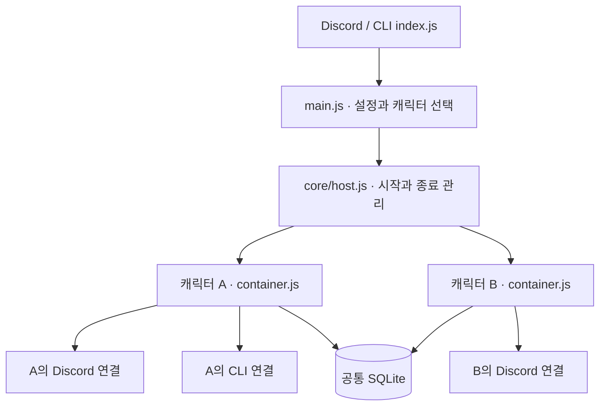
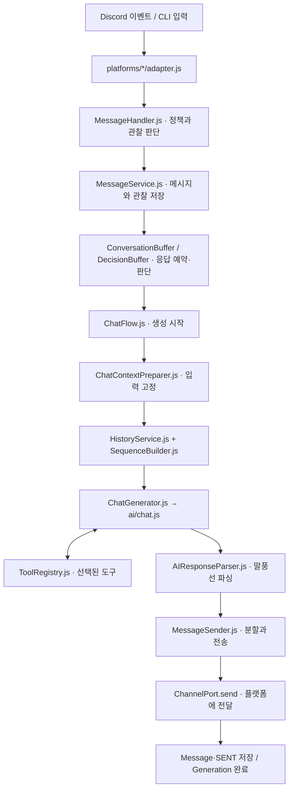

# 구조와 흐름

AiMate는 **프로세스 하나 → 캐릭터별 런타임 → 플랫폼별 연결**로 구성된다. Discord와 CLI는 입출력 방식만 다르며, 메시지 저장과 대화 생성은 같은 코드를 사용한다.

## 프로세스가 시작될 때

1. [main.js](../src/main.js)가 환경 변수와 YAML을 읽고 실행 대상을 고른다.
2. [host.js](../src/core/host.js)가 캐릭터별 설정과 연결을 준비한다. 모든 연결의 자기 계정 등록을 마친 뒤 입력을 연다.
3. [container.js](../src/core/container.js)가 캐릭터별 Repository·세션·버퍼·생성기·도구를 조립한다. 새로운 서비스의 의존성도 여기에서 연결한다.

캐릭터별 런타임은 서로 다른 세션과 생성 상태를 가진다. DB의 플랫폼 메시지는 공유하고, 누가 무엇을 읽었는지는 캐릭터별로 저장한다. 한 연결의 실패는 다른 연결을 유지하며, 사용할 수 있는 연결이 하나도 없으면 기동에 실패한다.

## 발언 하나가 답변이 되기까지

아래는 일반적인 CREATE 메시지 경로다. 수정과 삭제도 같은 `MessageHandler`로 들어온다.

### 1. 플랫폼 데이터를 공통 형태로 바꾼다

Discord의 [messageCreate.js](../src/platforms/discord/events/messageCreate.js)와 CLI의 [repl.js](../src/platforms/cli/repl.js)가 입력을 받는다. 각 `adapter.js`는 SDK 객체를 공통 `MessageEvent`와 `NormalizedMessage`로 바꾼다.

공통 형식은 [application/contracts.js](../src/application/contracts.js)에 있다. 대화 코드가 Discord의 `Message` 객체를 직접 다루지 않도록 하는 경계다.

### 2. 저장하고 응답할지 결정한다

[MessageHandler.js](../src/messages/MessageHandler.js)는 대화 정책과 로그 전용 채널 여부를 확인한다. 자기 계정의 수신 이벤트는 건너뛴다. 일반 외부 봇은 응답 대상으로 삼지 않으며, AiMate 캐릭터 소유 계정의 발언은 상호 대화 대상으로 처리한다.

[MessageService.js](../src/messages/MessageService.js)는 현재 메시지 상태와 캐릭터의 관찰 기록을 저장한다. 새 대화 세션이면 해당 연결로 최근 최대 50건을 읽어 문맥을 보충한다. 자세한 구분은 [데이터와 대화](데이터와%20대화.md)에 있다.

### 3. 연속 입력을 모으고 응답 방식을 정한다

[ConversationBuffer.js](../src/chat/ConversationBuffer.js)는 `responseMode: buffer`의 기본 경로다. 마지막 입력 후 `conversation.bufferTimeout`만큼 기다린다. 기본값은 5초이며, 추가 입력이 오면 타이머를 다시 건다.

[ConversationSession.js](../src/chat/ConversationSession.js)은 캐릭터·플랫폼·채널별 현재 작업을 `turnId`로 구분한다. buffer 모드에서는 새 입력이 응답을 요구하면 이전 생성을 취소하고 새 turn을 예약한다. 취소 신호는 [ChatGenerationAbortRegistry.js](../src/chat/ChatGenerationAbortRegistry.js)가 전달한다.

`responseMode: decision`에서는 [DecisionBuffer.js](../src/chat/decision/DecisionBuffer.js)가 마지막 입력 후 `conversation.decision.debounceMs`만큼 입력을 모아 참여 여부를 판단한다. 연속 입력의 예약 대기 상한은 `conversation.decision.maxWaitMs`다. 관찰만으로 진행 중인 turn을 취소하지 않고, 판단에 따라 유지·재시작·중단·대기를 적용한다. 상세 규칙과 문맥은 [응답 판단](응답%20판단.md)을 참고한다.

같은 채널의 상태 변경은 짧은 큐로 순서를 지킨다. 느린 모델 호출과 네트워크 전송이 끝날 때까지 입력 큐를 붙잡지는 않는다.

### 4. 모델이 볼 입력을 만든다

[ChatContextPreparer.js](../src/chat/context/ChatContextPreparer.js)가 관찰 기록을 조회하고, [SequenceBuilder.js](../src/chat/context/SequenceBuilder.js)가 프롬프트 팩의 `chat/sequence.js` 순서대로 문맥을 조립한다.

[PromptComposer.js](../src/chat/context/PromptComposer.js)는 캐릭터·시각·설정 데이터를 템플릿에 공급한다. 이번 생성이 처리할 입력과 관찰 snapshot은 모델 호출 전에 `Generation.input`에 고정한다.

### 5. 모델을 호출하고 말풍선을 얻는다

[ChatGenerator.js](../src/ai/ChatGenerator.js)는 [ai/chat.js](../src/ai/chat.js)를 통해 AI SDK를 호출한다. [ToolRegistry.js](../src/tools/ToolRegistry.js)는 현재 연결에서 사용할 수 있는 도구를 제공한다.

[AIResponseParser.js](../src/chat/response/AIResponseParser.js)가 응답의 `## messages` 구역과 `[BREAK]`를 해석해 문자열 배열을 만든다. 생성 이미지의 태그 보정 후 이 배열을 `Generation.output`에 저장한다.

### 6. 실제로 전달한 결과를 저장하고 완료한다

[MessageSender.js](../src/messages/MessageSender.js)는 길이 분할·첨부 해석·타이핑 지연을 처리하고 `ChannelPort.send()`를 호출한다. 플랫폼에서 전송을 확인한 뒤 `Message`와 `SENT` 관찰을 저장한다.

[ChatGenerationLifecycle.js](../src/chat/ChatGenerationLifecycle.js)와 [GenerationRepository.js](../src/repositories/GenerationRepository.js)가 생성 상태를 바꾼다. 정상 완료와 입력 처리 위치의 전진은 같은 트랜잭션에서 일어난다.

## 새 입력이 답변 도중 도착하면

buffer 모드에서는 즉시, Decision 모드에서는 재시작·중단·대기 판단을 적용할 때 abort를 요청한다. 늦게 돌아온 결과도 현재 turn이 아니면 전송하지 않는다. 여러 조각을 보내던 중이면 이후 조각을 중단한다. 이미 플랫폼에 전송을 요청한 조각은 화면에 나타날 수 있으며, 확인된 전송은 저장한다.

빈 `messages`도 정상 결과다. 답장·리액션만 하거나 완전히 침묵할 수 있으며, 완료한 입력은 다시 처리하지 않는다. 실제 전송이나 리액션이 없으면 `Generation.sentAt`은 비어 있다.

## 플랫폼 기능을 추가할 때의 경계

| 계약 | 책임 |
| --- | --- |
| `NormalizedMessage` | 플랫폼 식별자·작성자·본문·전송 시각의 공통 데이터. |
| `ChannelPort` | 전송·과거 내역 읽기·선택적 답장·리액션과 전송 제약. |
| `PlatformConnection` | 캐릭터 소유 계정의 준비·활성화·정책·입력 중단·종료. |
| 애플리케이션 유스케이스 | 생성 정보 조회·재생성·삭제·채널 목록 같은 사용자 작업. |

플랫폼 SDK 변환은 `platforms/`, 대화 규칙은 `messages/`와 `chat/`, DB 연산은 `repositories/`에서 찾는다. 파일별 역할은 [코드 지도](코드%20지도.md), 변경별 출발점은 [개발](개발.md)에 정리했다.

검증: [Host](../test/core/host.test.js), [컨테이너](../test/core/container.test.js), [대화 통합 테스트](../test/integration/ChatPipeline.integration.test.js).

[홈](홈.md) · [데이터와 대화](데이터와%20대화.md)
