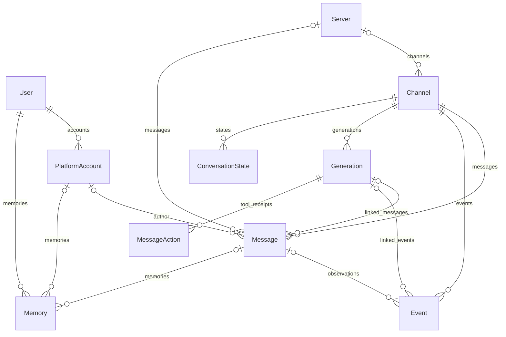

# 데이터 모델

Prisma 스키마는 SQLite를 사용한다. `npm run db:init`은 Client 생성과 db push를 실행하며 별도 migration 이력을 관리하지 않는다.



## 모델의 역할

| 모델 | 역할 |
| --- | --- |
| User | 사람·외부 봇·캐릭터의 공통 주체. nullable unique characterId로 캐릭터 정체성을 연결 |
| PlatformAccount | 플랫폼 사용자 ID와 handle·displayName |
| Server | 플랫폼 서버 식별자 |
| Channel | 플랫폼 채널, 선택적 서버, 마지막 발급 메시지 번호, 로그 수신 여부 logEnabled |
| Policy | 플랫폼·유형·범위·대상별 허용/거부, 임시 효과·만료, 선택적 서버, 변경자·시각 |
| Message | 채널별 고정 번호, 마지막 확인 본문·첨부, 작성자, 원래 전송 시각 sentAt, 수정·삭제 시각, 출력 Generation 연결 |
| Event | 캐릭터별 READ·EDIT·DELETE·SENT 경험과 불변 본문·첨부 snapshot, 관찰 중복 키 |
| ConversationState | 캐릭터·채널별 `handledThroughEventId` cursor |
| Generation | CHAT·IMAGE 생성의 상태, 고정 입력·출력, API 기록, sentAt·discardedAt |
| MessageAction | 생성별 reply/react 실행 고유 키와 결과 영수증. 결과 없음은 실행 중 또는 결과 미상 |
| Memory | 사용자 기억용 스키마. 현재 추출·검색 런타임은 연결되어 있지 않음 |

캐릭터 계정은 `BotAccountService`가 `User.characterId`로 같은 User에 연결한다. 캐릭터당 플랫폼별 계정 하나를 지원하며 기존 외부 사용자나 다른 캐릭터의 계정을 가져오지 않는다. 외부 계정의 User.characterId는 null이며, MessageService에서 처음 보는 외부 계정은 별도 User를 만든다. 계정 초기화의 소유권 확인·User 준비·계정 저장은 같은 트랜잭션이다.

Event와 Generation의 `characterId`는 문자열이며 Character 모델과 외래 키 관계가 없다. 캐릭터 정의는 파일에 있다. Event.messageId는 nullable이고 Message 삭제 시 SetNull 정책을 가진다. 일반 삭제는 행 삭제 대신 soft delete를 사용한다.

## 1단계 변경 적용

기존 개발 DB의 캐릭터 계정에는 소유권 연결이 없으므로 그대로 실행하면 외부 계정과의 충돌로 거부된다. 소유권을 추측해 채우는 마이그레이션은 제공하지 않는다. 앱을 종료하고 `.env`의 DATABASE_URL이 재구성할 개발 DB를 가리키는지 확인한 뒤 프로젝트 루트에서 실행한다. 아래 reset은 해당 DB의 기존 데이터를 삭제한다.

```powershell
npm run db:generate
npm run db:push -- --force-reset
```

그 뒤 Discord 또는 CLI를 실행하면 캐릭터 User와 해당 플랫폼 계정이 준비된다. 자동 테스트는 별도의 임시 DB를 사용하며 실제 개발 DB를 재구성하지 않는다.

2단계에서도 Event.observationKey와 관찰 고유 키가 추가되었고 Message.generationId의 의미가 출력 연결로 바뀌었다. 이전 입력 연결이나 관찰 키를 추정해 이관하지 않으므로 같은 절차로 개발 DB를 재구성한다. 새 스키마 검증은 임시 DB에서 수행하며 실제 개발 DB reset은 자동 실행하지 않는다.

Generation의 type·status, Event의 kind·source, Policy의 scope는 Prisma enum이 아니라 String이다. 스키마 주석에 있는 VOICE·EMBEDDING이나 PENDING을 모두 실제 생성 경로로 해석하지 않는다. 현재 주 사용 경로는 CHAT과 IMAGE다.

Policy는 `(platform, type, scope, targetId)` 복합 기본 키를 사용하며 Channel·Server 행 없이도 정책을 저장한다. platformServerId는 서버별 조회를 위한 nullable 외부 식별자다. nullable effect는 기본 허용/거부이며 null이면 상속한다. temporaryEffect·expiresAt는 임시 효과다. 만료된 임시 값은 판정에서 무시한다. 현재 등록·집행하는 유형은 conversation이며 다른 동작의 정책은 기능 구현 시 추가한다. Channel.scope와 과거 채널 등록 기반 Discord 활성화 계약은 제거했으며 설정을 이관하지 않는다. [권한과 정책](../구조/권한과%20정책.md), [Discord 정책](../플랫폼/Discord%20정책.md)을 참고한다.

## 필드 묶음으로 읽기

Message의 content·attachmentsJson·editedAt·deletedAt는 마지막으로 확인한 플랫폼 상태를, authorId·channelId·serverId는 소속을, generationId는 출력 연결을 나타낸다. 입력 사용 기록은 각 Generation.input에만 남긴다. SENT는 명시적인 전송 확인이며 isBot이 소유권이나 전송 성공을 결정하지 않는다.

Message.sentAt은 nullable 원래 플랫폼 전송 시각이며 최초 저장 시 기록하고 수정·삭제 시 바꾸지 않는다. DB 저장 시각 createdAt, 사건을 읽은 시각 Event.observedAt, 생성의 마지막 전달 확인 시각 Generation.sentAt과 구분한다. 전송 시각이 없는 기존 데이터나 삭제 tombstone은 null로 남기며 추정·소급 채우기를 하지 않는다. 모델용 Event snapshot에는 대상 Message.sentAt을 복사해 재생성 입력에도 보존한다.

Message.channelMessageNo와 Channel.lastMessageNo는 첫 저장 트랜잭션에서 함께 기록한다. 모델용 Event snapshot에도 번호를 포함해 재생성 시 동일한 대상을 유지한다. 번호와 관찰 시각·사건 순서는 별개의 정보다.

Event의 snapshotContent·snapshotAttachmentsJson은 당시 관찰 본문이다. previousContent는 EDIT 설명에, batchId는 일괄 삭제 묶음에 사용한다. source=HISTORY와 kind=READ의 조합은 현재 과거 내역을 읽는 경험이고, 과거 시점에 편집을 목격했다는 뜻이 아니다.

Event의 `(characterId, platform, platformMessageId, observationKey)`는 고유하다. LIVE CREATE·SENT·DELETE는 사건 종류를 키로, EDIT는 플랫폼 observationId 또는 editedAt을 포함한 키로 중복을 막는다. 명시적으로 다시 읽은 HISTORY는 observationKey=null이어서 새로운 읽기 경험을 남길 수 있다. 공통 Message 변경이 없어도 다른 캐릭터의 Event는 새로 기록될 수 있다.

Generation의 apiRequest·apiResponse·metadata는 JSON 문자열이고 output은 type에 따라 CHAT 메시지 배열 또는 IMAGE 파일명이다. IMAGE input은 렌더링한 프롬프트 문자열, CHAT input은 입력 사건 snapshot을 포함하는 JSON이다. 다른 type을 추가하면 이 의미 차이를 명시해야 한다.

CHAT metadata.timings.generatedAt은 출력과 GENERATED 상태를 저장하는 시각, completedAt은 COMPLETED 상태를 저장하는 시각이다. 단계 경계를 ISO 문자열로 기록하며 응답·요청 원문을 중복 저장하지 않는다. [Discord 생성 로그](../운영/로그.md)의 생성·전송 소요 시간은 이 시각을 사용한다.

## 영속 상태와 메모리 상태

| 정보 | 저장 위치 | 재시작 뒤 유지 |
| --- | --- | --- |
| 최신 메시지와 관찰 사건 | Message·Event | 유지 |
| 처리 완료 위치 | ConversationState | 유지 |
| 생성 상태·입력·출력 | Generation | 유지 |
| 도구 작업 시작·확인 결과 | MessageAction | 유지 |
| Discord 로그 수신 설정 | Channel.logEnabled | 유지 |
| 유형별 권한 정책·기본/임시 효과·만료 시각 | Policy | 유지 |
| Discord 로그 카드 ID·표시 상태·대기 묶음 | DiscordLogService의 Map | 초기화 |
| 캐릭터 정의와 프롬프트 | content 파일 | 파일이 존재하면 유지 |
| 현재 turn과 주시 종료 시각 | ConversationSession | 초기화 |
| 예약 타이머와 abort controller | Buffer·AbortRegistry | 초기화 |

주시 여부를 DB cursor로 복원하지 않는다. cursor는 처리 진행도이고 주시는 최근 작업의 시간 범위이기 때문이다. 반대로 세션이 초기화됐다는 이유로 과거 경험이나 cursor를 삭제하지 않는다.

## 근거와 검증

구현: `prisma/schema.prisma`, `src/database/client.js`, `src/accounts/BotAccountService.js`, `src/repositories/PlatformAccountRepository.js`, `src/messages/MessageService.js`, `src/repositories/GenerationRepository.js`.

테스트: `test/accounts/BotAccountService.test.js`(다중 플랫폼 소유권·재시작·충돌 거부·롤백), `test/messages/MessageService.test.js`, `test/chat/ChatGenerationLifecycle.test.js`, `test/integration/ChatPipeline.integration.test.js`.

[홈](../홈.md) · [저장과 식별자](저장과%20식별자.md) · [메시지와 관찰 사건](../대화/메시지와%20관찰%20사건.md)
