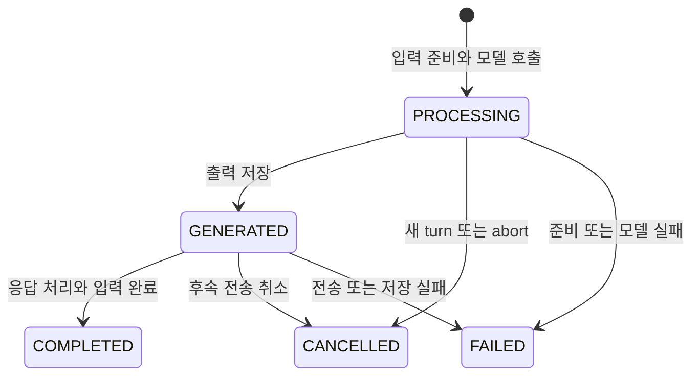

# 데이터와 대화

대화 코드를 읽을 때는 **현재 메시지**, **캐릭터가 관찰한 내용**, **이번에 처리할 입력**, **모델에 보여줄 문맥**을 구분해야 한다. 이 구분이 수정·삭제·취소·재생성의 기준이다.

## 먼저 알아둘 네 가지

| 개념 | 저장 위치 | 역할 |
| --- | --- | --- |
| 현재 메시지 | `Message` | 플랫폼 메시지 하나의 최신 상태. 캐릭터들이 공유한다. |
| 관찰 기록 | `Event` | 특정 캐릭터가 읽거나 수정·삭제를 목격하거나 전송한 경험. 본문 snapshot을 남긴다. |
| 처리 위치 | `ConversationState` | 캐릭터·채널별로 어디까지 입력을 처리했는지 기록한다. |
| 모델 작업 | `Generation` | 한 번의 채팅·이미지 생성 또는 Decision 판단에 사용한 입력, 출력, API 기록과 상태. |

스키마는 [prisma/schema.prisma](../prisma/schema.prisma), 저장 조정은 [MessageService.js](../src/messages/MessageService.js), 관찰 조회는 [EventRepository.js](../src/repositories/EventRepository.js)에 있다.

## 수정된 메시지와 수정 목격은 다르다

예를 들어 사용자가 “내일 가자”라고 보낸 뒤 “오늘 가자”로 수정했다고 하자.

| 캐릭터의 상황 | 현재 Message | 캐릭터의 관찰 |
| --- | --- | --- |
| 원문을 읽고 수정도 목격 | “오늘 가자” | READ와 EDIT. 이전에 읽은 내용도 알 수 있다. |
| 원문만 읽고 수정은 목격하지 않음 | “오늘 가자” | 기존 READ. DB의 최신 값으로 과거 경험을 바꾸지 않는다. |
| 나중에 과거 내역에서 처음 읽음 | “오늘 가자” | HISTORY READ. 수정 표시가 있어도 수정 시점을 목격한 것으로 설명하지 않는다. |

[ConversationSession.js](../src/chat/ConversationSession.js)은 진행 중인 turn과 이후 10분의 유예 동안 관찰을 유지한다. 정상 응답의 유예는 마지막 전송·작업 성공 확인 시점부터, 완전한 무응답은 완료 시점부터 계산한다. 활성 대화에서 수정·삭제를 목격하면 새 입력으로 반영한다. 관찰 기간 밖에서도 저장된 메시지의 현재 상태는 갱신할 수 있다.

새 세션에서 과거 내역을 읽을 때는 해당 플랫폼 계정으로 최근 최대 50건을 조회한다. 조회가 실패하거나 권한이 없으면 공통 DB의 최신 본문으로 대신 채우지 않는다. 캐릭터마다 다른 계정으로 읽은 내용이 다를 수 있기 때문이다.

## 모델 문맥과 처리할 입력

[HistoryService.js](../src/messages/HistoryService.js)는 캐릭터의 Event를 관찰 순서로 읽는다. 아직 처리하지 않은 LIVE READ·EDIT·DELETE 중 응답 대상이 이번 입력이 된다. HISTORY로 읽은 메시지는 문맥을 제공한다.

`historyMessages`와 `pendingMessages`는 프롬프트에서 기록을 배치하는 구분이다. 마지막 자기 발언의 SENT를 기준으로 나누며, DB의 처리 완료 위치와 같은 개념은 아니다. 모델에는 과거 문맥도 제공하지만, 완료할 입력 범위는 별도로 고정한다.

CHAT의 `Generation.input`에는 입력 메시지 목록과 `eventSnapshot`을 저장한다. 정상 완료 시 `ConversationState.handledThroughEventId`를 전진시킨다. 실패·취소는 완료 위치를 전진시키지 않는다. DECISION 기록은 판단 state와 관찰 범위를 저장하며 이 위치를 전진시키지 않는다.

## 생성 기록을 읽는 방법

| 필드·기록 | 무엇을 보여주는가 |
| --- | --- |
| `Generation.input` | 이번 생성의 입력 메시지와 고정한 관찰 snapshot. |
| `Generation.apiRequest` / `apiResponse` | 모델 설정·프롬프트·SDK 단계·도구 호출과 응답 등 저장한 API 메타데이터. |
| `Generation.output` | CHAT은 파싱·이미지 태그 보정 후, 길이 분할 전의 말풍선 배열. IMAGE는 생성 파일 이름. DECISION은 행동과 확률의 JSON. |
| `Message` + SENT `Event` | 플랫폼에서 실제 전달을 확인한 결과. |
| `Generation.sentAt` | 실제 전송·메시지 작업의 마지막 성공 확인 시각. 완전한 무응답이면 null. |

모델이 생성한 전체 응답과 사용자가 받은 내용은 다를 수 있다. 전송 중 취소되면 `Generation.output`에는 전체 말풍선이 남고 `Message`에는 확인된 조각만 남는다.

DECISION의 `COMPLETED`는 판단 API가 성공했다는 뜻이다. 실제 적용 여부와 폐기 사유는 `metadata.application`으로 구분한다. 판단 기록은 관찰용 `Event`를 생성하거나 Event의 생성 소유권을 바꾸지 않는다. 필드와 상태별 의미는 [응답 판단](응답%20판단.md#관찰과-처리-위치)을 참고한다.

CHAT의 주요 상태 전이는 다음과 같다.

`COMPLETED`에는 침묵도 포함한다. 무응답 `[]`는 입력 처리를 마치고 `sentAt`을 비워 둔다. 생성 실패는 로그로 보고하며 별도의 캐릭터 안내 발언을 만들어 저장하지 않는다.

## 식별자와 시각

| 값 | 용도 |
| --- | --- |
| `Message.id`, `Channel.id` | 내부 DB 식별자. |
| `platformId`, `platformMessageId`, `platformChannelId` | Discord·CLI 등 플랫폼의 원본 식별자. 이름은 계층에 따라 다르다. |
| `Message.channelMessageNo` | 채널 안의 고정 메시지 번호. 모델에 `#번호`로 보여주며 reply/react가 참조한다. |
| `Event.id` | 관찰 순서와 입력 처리 위치. |
| `turnId` | 메모리에서 현재 대화 작업의 소유권을 확인하는 UUID. |
| `Generation.id` | 생성 작업·로그·출력을 연결하는 DB 식별자. |

고정 메시지 번호는 수정·삭제·과거 내역 조회 후에도 유지하며 번호 순서가 실제 전송 순서라는 보장은 없다. reply/react는 해당 캐릭터가 관찰한 번호를 대상으로 한다.

`Message.sentAt`은 원래 플랫폼 전송 시각, `Event.observedAt`은 캐릭터의 관찰 시각, `createdAt`은 DB 기록 시각이다. 모델용 날짜·시간 헤더는 원래 전송 시각을 사용하며 알 수 없으면 생략한다. 멘션 원문은 저장하고 표시할 때 현재 이름으로 바꾼다.

## 나머지 모델의 역할

| 모델 | 역할 |
| --- | --- |
| `User` | 내부 사용자. `characterId`가 있으면 AiMate 캐릭터의 정체성. |
| `PlatformAccount` | User에 연결된 플랫폼 계정. 한 캐릭터의 Discord·CLI 계정을 같은 User에 연결한다. |
| `Server`, `Channel` | 플랫폼 서버·채널. Channel은 메시지 번호를 발급한다. |
| `Policy` | 캐릭터·플랫폼·기능·범위별 허용·거부·상속과 임시 효과. |
| `LogSubscription` | 캐릭터별 로그 수신 채널. |
| `MessageAction` | 생성 중 reply/react 같은 외부 작업의 결과를 보존해 같은 작업의 반복 실행을 막는다. |
| `Memory` | 장기 기억용 스키마. 현재 대화 생성의 추출·검색·주입 경로에는 연결되어 있지 않다. |

정책·생성·관찰·처리 위치·로그 구독은 캐릭터 범위를 가진다. 자기 계정 준비 시 외부 사용자나 다른 캐릭터 소유 계정을 가져오지 않는다. 계정 소유권 처리는 [BotAccountService.js](../src/accounts/BotAccountService.js)에 있다.

## 재생성

[RerollConversation.js](../src/application/RerollConversation.js)는 자기 캐릭터의 출력인지 확인하고 원래 `Generation.input`의 관찰 snapshot을 재사용한다. 기존 생성은 `discardedAt`으로 철회하고 실제 삭제에 성공한 메시지를 반영한 뒤 다시 생성한다. 처리 위치를 과거로 되돌리지는 않는다.

철회한 자기 출력은 이후 문맥에서 제외한다. 다른 캐릭터가 이미 읽은 경험은 남으며, 실제 삭제를 목격하면 그 캐릭터의 DELETE 기록이 추가된다.

검증: [메시지 저장](../test/messages/MessageService.test.js), [히스토리](../test/messages/HistoryService.test.js), [대화 통합 테스트](../test/integration/ChatPipeline.integration.test.js). 통합 테스트는 캐릭터별 관찰, 취소·부분 전송, 무응답 완료, 고정 번호와 재생성을 실제 임시 DB로 확인한다.

[홈](홈.md) · [구조와 흐름](구조와%20흐름.md) · [운영](운영.md)
